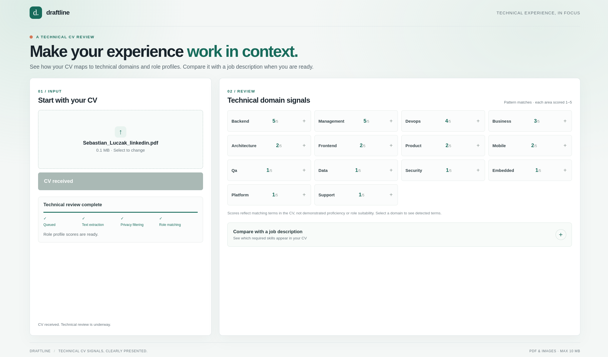

= CV Platform - draftline

Microservice-based platform for managing and processing CVs (resumes).

.Alpha version of UI

== Tech Stack

Written in Golang and React.

From the infrastructure point of view, it requires:

. RabbitMQ
. S3-compatible storage

Optionally processes sent data through an AI model to assign a weight to the CV, but the core functionality works without any AI model.

Opens SSE connection to the client for real-time signals.

== Running

`cp .env.dist .env` <- copy the dist env vars

`vi .env` <- set your keys, quit vim

`devenv up` <- run the beast

Visit http://localhost:5173/

== Documentation

See link:https://sebastianluczak.github.io/cv-platform[CV Platform Documentation] hosted on GitHub Pages.

NOTE: This site is automatically built from `./docs` directory on every merge to `main`.

== Agentic issue workflow

IMPORTANT: This functionality works only for maintainers.

Let the AI agent implement a task for you!

. Create a GitHub issue describing the desired change.
. Add the `agent:run` label (requires repository write access).
. Wait for the workflow to validate the changes and open a pull request.

The agent can modify supported application code and documentation, but cannot execute arbitrary commands or change workflow, dependency, or build infrastructure files. Failed validation is reported on the issue, with one automatic repair attempt.

=== Maintainer setup

Configure the `agent:run` label, the `OPENROUTER_API_KEY` secret, the `OPENROUTER_MODEL` variable, and a GitHub App with the permissions and credentials documented in the workflow configuration. 

Enable squash merging and auto-merge, and protect the default branch with the required `build` check.

IMPORTANT: **Security notice:** Issue content and relevant repository files are sent to OpenRouter and its serving provider. Do not use this workflow for confidential data. Unsupported models fail rather than being silently replaced.